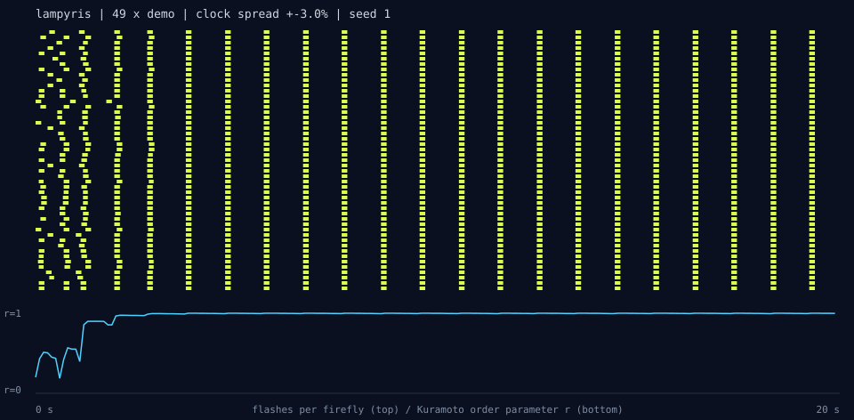
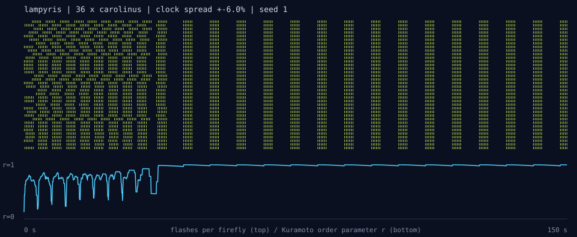
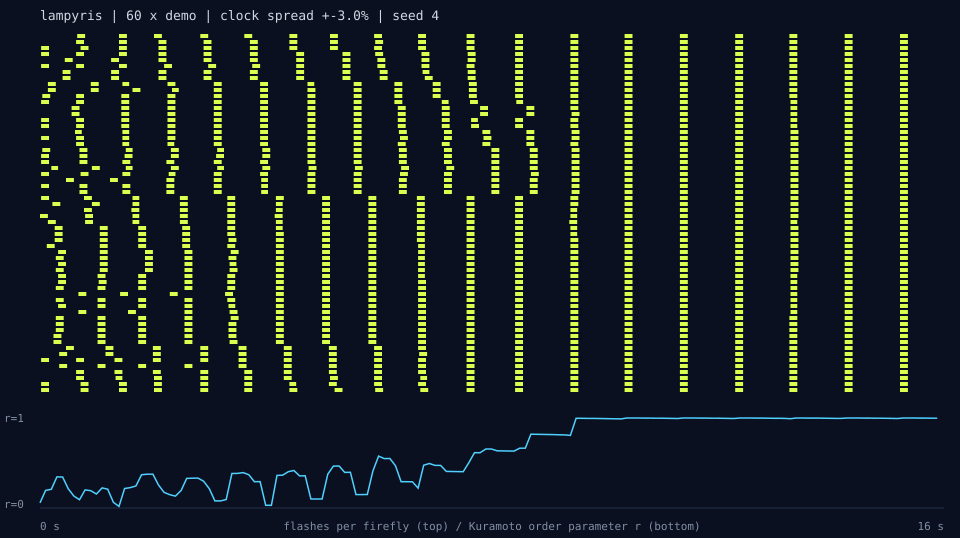

# lampyris

**A swarm of tiny microcontrollers that learn to blink in unison the way fireflies do, with no radio, no shared clock and no leader.**

Each node has exactly one LED. It uses that LED to **flash** and also to **see**: between flashes the LED is reverse-biased and works as a photodiode. Scatter a handful of nodes around a dark room, switch them on at random times, and within a few cycles they are blinking as one.



*Top: every row is one firefly and every yellow tick is a flash. Bottom: the Kuramoto order parameter r, where 0 means chaos and 1 means perfect unison. Produced by the real firmware core running in the simulator (`make figures`).*

---

## Why it's interesting

- **One part per node.** Each node needs an MCU, an LED and a resistor. The LED is the lantern and the eye (see [LED-as-sensor](#the-led-is-the-eye)).
- **The physics is real.** Nodes are pulse-coupled oscillators (Mirollo & Strogatz, 1990). Nodes only influence each other through light, and the simulator models nothing else. A blindfolded swarm never syncs, and a test proves it.
- **It survives the real world.** An onset detector catches a new flash even while other neighbours are still glowing, tracks dusk falling from daylight to dark, and recovers when someone switches on a porch light.
- **It's honest about clocks.** Every node runs on its own crystal or RC oscillator, and the simulator gives each one a different natural period. Optional **frequency adaptation**, modelled on Southeast Asian *Pteroptyx* fireflies, lets nodes adjust their tempo as well as their phase.
- **Tiny and integer-only.** The core uses no floats, no `malloc` and no RTOS. A whole firefly is 82 bytes of RAM on AVR, so it fits an ATtiny85.
- **Tested like software.** 395 checks run with gcc and clang under ASan/UBSan, plus swarm-level tests that run hundreds of simulated fireflies across many seeds. CI also compiles the firmware for Uno, Nano, Leonardo and Raspberry Pi Pico.

## Quick start (no hardware needed)

```sh
make test          # unit + swarm tests
make demo          # 49 fireflies, raster before/after, sync sparkline
make live          # watch 100 fireflies sync in your terminal
./build/swarm --help
```

```
  dusk: everyone for themselves  (0.0 s .. 8.0 s, 16 of 49 fireflies)
    0 |##    ##      ##      ##       ##       ##      ###      ###      ##    |
    6 |  ##   ##     ##      ###      ##       ##      ###      ###      ##    |
   12 |  ###  ##     ##      ###      ##       ##      ###      ###      ##    |
   44 |   ##  ##     ##      ###      ##       ##      ###      ###      ##    |
  ...
  later: one organism  (22.0 s .. 30.0 s, 16 of 49 fireflies)
    0 |#       ##      ###      ##       ##       ##      ###      ##       ## |
    6 |#       ##      ###      ##       ##       ##      ###      ##       ## |
  ...
  sync r(t) |-=%@@@@@@@@@@@@@@@@@@@@@@@@@@@@@@@@@@@@@@@@@@@@@@@@@@@@@@@@@|  0 .. 30 s

locked after 1.6 s (1.6 cycles); final r = 1.000; 1822 flashes seen, 1493 absorptions
```

Try `--layout ring`, `--layout scatter`, `--dusk 20`, `--noise 40`, `--jitter 12`, `-s carolinus` or `--svg out.svg`.

## Build a swarm

Per node:

| Part | Notes |
|---|---|
| Any Arduino-compatible MCU | Uno, Nano, Leonardo and Pico are built in CI. ATtiny85 pins are pre-defined. |
| 1 LED | Water-clear, high-brightness. Use **identical LEDs** across the swarm: an LED senses best at or slightly below its own emission wavelength. |
| 1 × 220 Ω | In series with the LED |
| Power | A coin cell or a 2×AA holder per node |

```
   PIN_ANODE (D2) ---[ 220R ]---|>|--- PIN_CATHODE (D3)
```

1. Open `firmware/lampyris/lampyris.ino` in the Arduino IDE (or run `arduino-cli compile --fqbn arduino:avr:nano firmware/lampyris`).
2. Choose a species at the top of the sketch, then flash every node.
3. Place the nodes 5–30 cm apart, facing each other, in a dark room. Power them up at random moments and watch.

Define `LAMPYRIS_DEBUG` to log every fire with its current period, the ambient level, flashes heard and absorptions. If your LEDs are weak sensors, tune `SENSE_TIMEOUT_US` and `SENSE_SCALE`. You can also define `LAMPYRIS_SENSE_ANALOG` and add a phototransistor on `A0`.

### The LED is the eye

An LED is a photodiode that happens to be bad at its job, and that's still good enough. To sense, the firmware:

1. Reverse-biases the LED (anode LOW, cathode HIGH) to charge its junction capacitance.
2. Floats the cathode and counts how long the charge takes to leak away.
3. Uses the timing: light generates photocurrent, so a brighter scene means a faster discharge.

The technique is from Dietz, Yerazunis & Leigh, *Very Low-Cost Sensing and Communication Using Bidirectional LEDs* (MERL, 2003). Because an LED can't see while it shines, the firmware is blind while glowing and for 25 ms afterwards. `lp_ff_wants_sample()` tells the sketch when its eye is open.

## How it works

```
 light ──► onset detector ──► pulse-coupled oscillator ──► flash pattern ──► LED
              ▲                                                      │
              └─────────────── blind while glowing ──────────────────┘
```

**Oscillator** (`oscillator.c`): each node's phase rises from 0 to 1 and the node flashes when it reaches the top. When the node sees a neighbour flash at phase φ, it jumps ahead:

    φ ← φ · (1 + c) + ε        (fire immediately if this reaches 1)

Nodes near the end of their cycle get pushed over the edge and fire together with the neighbour. Mirollo and Strogatz proved that this absorption only ever *merges* groups and never splits them. A refractory window after each fire makes the node ignore its own group's echo, which keeps a merged group stable.

**Frequency adaptation** (optional per species): when a neighbour's flash arrives late in our cycle, the neighbour is ahead of us, so we shorten our period. When it arrives early, we lengthen it. Each cycle the period also relaxes back toward the node's natural rhythm, within ±10–15%. Without that relaxation, adaptation turns into a ratchet: the swarm speeds up until every node is pinned against its own (different) clamp, and the clock spread comes back. The first version did exactly that. See the table below.

**Onset detector** (`detector.c`): detects *jumps* above a fast-following recent level, not light above an absolute baseline. A level detector goes deaf in a busy swarm, because some neighbour is almost always glowing; that was the first bug the simulator found. A slow ambient baseline scales the threshold, so the same firmware works at dusk and under a porch light.

**Species** (`species.c`):

| Preset | Period | Pattern | Adaptation | Inspired by |
|---|---|---|---|---|
| `demo` | 1 s | one 120 ms flash | off | easy to watch and debug |
| `pteroptyx` | 560 ms | one 90 ms flash | on | mangrove fireflies of Southeast Asia, which sync whole riverbanks |
| `carolinus` | 8 s | burst of 6 flashes, then dark | on | *Photinus carolinus*, the synchronous fireflies of the Great Smoky Mountains |



## Results

From the simulator: 49-node grid, 60 s (`carolinus`: 36 nodes, 300 s), 30 seeds per cell. "Clock spread" is each node's natural period drawn uniformly within ±X% of nominal. A run counts as locked when r ≥ 0.95 and stays ≥ 0.90 to the end.

| Scenario | Locked |
|---|---|
| `demo`, ±3%, grid | 30/30 |
| `demo`, ±8%, grid | 30/30 |
| `demo`, dusk from daylight to dark | 30/30 |
| `demo`, 5× sensor noise | 30/30 |
| 144 nodes, random scatter | 30/30 |
| 40 nodes on a ring (sync has to travel around it) | 30/30 |
| `pteroptyx`, ±12% | 30/30 |
| `carolinus`, ±6% | 28/30 |

**Does frequency adaptation help?** Sometimes. These are the honest numbers:

| Setting | Adaptation off | Adaptation on |
|---|---|---|
| `pteroptyx` timing, coupling 26/256, ±8% (adaptation gain 2⁻⁵) | 16/30 | 25/30 |
| `pteroptyx` timing, coupling 64/256, ±12% | 19/30 | 29/30 |
| `pteroptyx` timing, coupling 96/256, ±15% | 30/30 | 28/30 |
| `carolinus` timing, coupling 64/256, ±6% | 23/30 | 28/30 |

Adaptation rescues weakly coupled swarms and burst-pattern species. With strong coupling, absorption alone already handles the clock spread, and adaptation adds a little wobble.

Sync can't jump across a ring; it has to travel around it, so you can watch it spread:



## Repository layout

```
firmware/lampyris/            Arduino sketch (open this folder in the IDE)
  lampyris.ino                LED-as-sensor hardware layer
  src/oscillator.[ch]         pulse-coupled oscillator + frequency adaptation
  src/detector.[ch]           onset detector with ambient tracking
  src/species.[ch]            presets and flash patterns
  src/firefly.[ch]            ties it together: one call per sample
sim/world.[ch]                light-propagation model; runs the real core
sim/swarm.c                   CLI: raster, sparkline, live view, SVG, CSV
test/test_lampyris.c          unit + swarm-level tests
```

## References

- R. E. Mirollo, S. H. Strogatz. *Synchronization of pulse-coupled biological oscillators.* SIAM J. Appl. Math. 50(6), 1990.
- G. B. Ermentrout. *An adaptive model for synchrony in the firefly Pteroptyx malaccae.* J. Math. Biol. 29, 1991.
- P. Dietz, W. Yerazunis, D. Leigh. *Very Low-Cost Sensing and Communication Using Bidirectional LEDs.* MERL TR2003-35, 2003.
- J. Buck. *Synchronous rhythmic flashing of fireflies. II.* Q. Rev. Biol. 63(3), 1988.

## License

MIT
